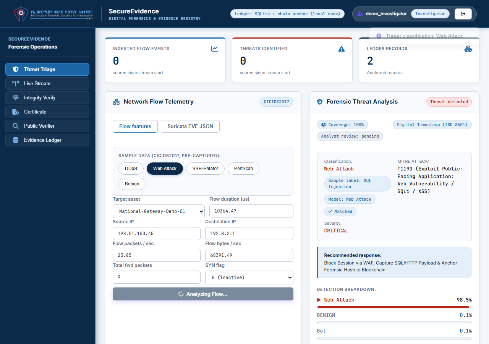
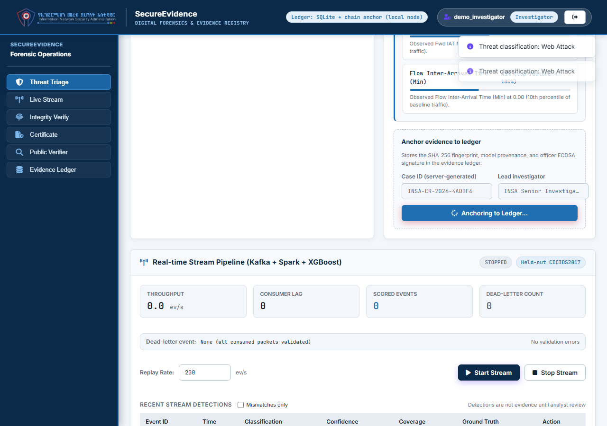
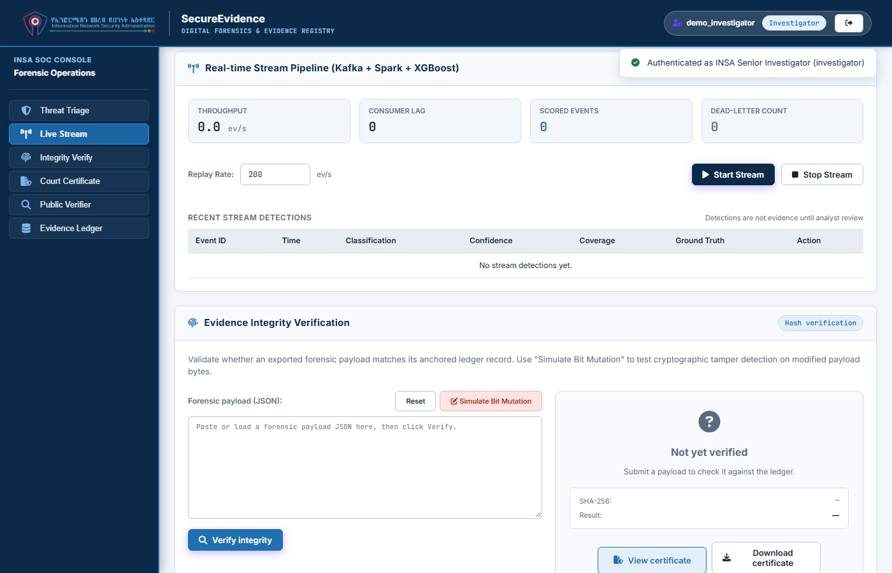
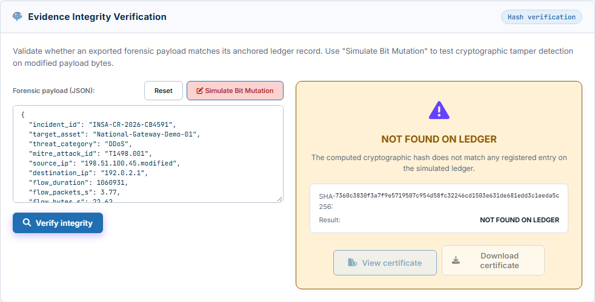
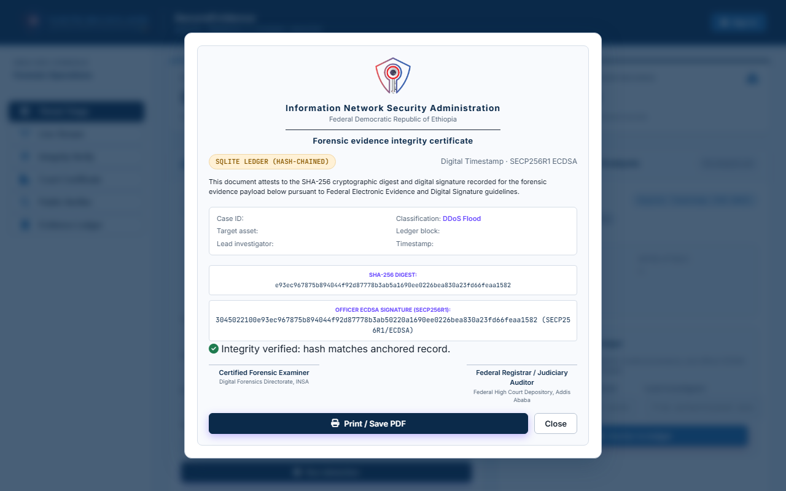

# SecureEvidence
### AI Threat Detection & Court-Admissible Blockchain Evidence Ledger for INSA

[](https://secureevidence.onrender.com)
[](https://www.python.org/)
[](https://fastapi.tiangolo.com/)
[](https://xgboost.readthedocs.io/)
[](https://soliditylang.org/)
[](https://hardhat.org/)
[](https://www.linkedin.com/in/nathenael-ermias-753746428?utm_source=share_via&utm_content=profile&utm_medium=member_android)
[](mailto:nathenaelermias13@gmail.com)

---

## 🌐 Live Application
You can test the deployed application directly in your browser:  
👉 **[https://secureevidence.onrender.com](https://secureevidence.onrender.com)**

### Quick Demo Access:
| Role | Username | Password | Operational Scope |
| :--- | :--- | :--- | :--- |
| **Investigator** | `demo_investigator` | `DemoTestPassword123!` | AI Threat Detection, TreeSHAP Feature Analysis, Blockchain Evidence Anchoring, Tamper Verification |
| **Admin** | `demo_admin` | `DemoTestPassword123!` | Full System Administration, Audit Trail Inspection, Chain Recovery |

*(Tip: On the Sign-In modal, simply click the **Investigator** or **Admin** button to auto-fill credentials instantly.)*

---

## 📌 Why I Built SecureEvidence

When digital forensic teams at the **Information Network Security Administration (INSA)** investigate cyber incidents or seize compromised systems, they face a recurring challenge in court under Ethiopia's *Computer Crime Proclamation No. 958/2016* and *Electronic Signature Proclamation No. 1072/2018*:

> **"How does the court verify that the server logs, packet captures, and forensic artifacts weren't altered after being seized?"**

Standard syslog files, text logs, and ordinary database records are easy to modify or delete. Defense attorneys can challenge digital evidence simply by pointing out that anyone with root access could have altered timestamps, IP addresses, or payload bytes.

**SecureEvidence** was built as a capstone project during the INSA Summer Camp to solve this problem by combining three technologies into one workflow:

1. **AI Threat Detection Engine**: Classifies incoming network flows into 12 distinct threat categories using an **XGBoost** model trained on benchmark **CICIDS2017** data. It uses **TreeSHAP** to show exactly *which* network metrics (packet rate, flow duration, window size) caused the model to trigger an alert.
2. **Big Data Processing Layer**: Simulates real-time telemetry ingestion using **Apache Spark Structured Streaming** and Kafka event streams, aggregating 1-minute window metrics to handle high-volume traffic.
3. **Cryptographic Blockchain Ledger**: When an investigator verifies a threat, the system computes a deterministic **SHA-256 canonical hash** of the forensic record and anchors it to an **Ethereum smart contract** (`EvidenceTracker.sol`) alongside a local hash-chained SQLite ledger.

If anyone modifies even a single byte of the evidence afterward, the recomputed hash fails to match the anchored record, immediately alerting the court to tampering.

---

## 🏛️ System Architecture

```text
                                +-----------------------------------------------+
                                |     ETHIOPIAN CRITICAL INFRASTRUCTURE         |
                                |  (Ethio Telecom, CBE, NBE, Gov Gateways)      |
                                +-----------------------+-----------------------+
                                                        | NetFlow / IP Flow Data
                                                        v
                                +-----------------------------------------------+
                                |        1. BIG DATA INGESTION LAYER            |
                                |       (Spark Structured Streaming)            |
                                +-----------------------+-----------------------+
                                                        | Flow Feature Extraction
                                                        v
                                +-----------------------------------------------+
                                |        2. AI THREAT DETECTION ENGINE          |
                                |      (XGBoost + TreeSHAP Explainability)      |
                                +-----------------------+-----------------------+
                                                        | Telemetry & Attribution
                                                        v
                                +-----------------------------------------------+
                                |          3. BACKEND FORENSIC API              |
                                |         (FastAPI & SHA-256 Engine)            |
                                +-----------+-----------------------+-----------+
                                            |                       |
              Deterministic SHA-256 Digest  |                       | REST & WebSockets
                                            v                       v
        +-----------------------------------------------+   +-----------------------------------------------+
        |     4. EVIDENCE BLOCKCHAIN & LEDGER           |   |          5. FORENSIC WEB CONSOLE              |
        |  - Solidity Smart Contract (EVM / Hardhat)    |   |  - Real-Time AI Detection & TreeSHAP          |
        |  - SQLite Verifiable Hash Chain               |   |  - One-Click Blockchain Anchoring             |
        |  - Merkle Tree Proofs & ECDSA Signatures      |   |  - Interactive Tamper-Testing Engine          |
        |  - RFC 8785 Canonical JSON Serialization      |   |  - Printable Federal Court Certificate        |
        +-----------------------------------------------+   +-----------------------------------------------+
```

---

## ⚡ Core Capabilities

### 1. AI Threat Detection (`ai_engine/`)
* **Benchmark Dataset**: Trained on the Canadian Institute for Cybersecurity **CICIDS2017** dataset.
* **12 Threat Classes**: Classifies complex volumetric floods (DDoS, DoS Hulk), service discovery (PortScan), command & control (Botnet), credential abuse (SSH-Patator, Web Brute Force), application exploits (SQL Injection), and baseline BENIGN traffic.
* **Explainable AI (TreeSHAP)**: Rather than giving a blind score, the console breaks down the top mathematical drivers of each decision (e.g. forward packet volume, inter-arrival time mean, TCP SYN flags).
* **Coverage Safeguard**: If telemetry contains fewer than 60% of expected flow parameters, the engine flags `INSUFFICIENT_DATA` rather than making blind assumptions or filling zeros.

### 2. Blockchain & Cryptographic Sealing (`blockchain/`)
* **Smart Contract (`contracts/EvidenceTracker.sol`)**: Solidity contract providing role-based access control, SHA-256 Merkle root verification, and emitted event logs (`EvidenceStored`, `EvidenceVerified`).
* **Dual-Layer Storage**:
  * **On-Chain**: Anchors root hashes to the Ethereum/Hardhat blockchain.
  * **Local Verifiable Ledger**: SQLite database with append-only triggers and a cryptographic hash chain where each block embeds `prev_hash`, chaining back to genesis.
* **Officer Non-Repudiation**: Digital signatures generated via SECP256R1 ECDSA to cryptographically tie each piece of evidence to the investigating officer.
* **Tamper Proofing**: Modifying any field (source IP, timestamp, flow bytes) immediately breaks the chain and produces a red mismatch alert.

### 3. Big Data Processing (`big_data/`)
* **Spark Structured Streaming**: Streams raw network telemetry through schema validation and vectorization pipelines.
* **Sliding Window Analytics**: Tracks 1-minute throughput, packet rates, and anomaly distributions in real time.
* **Traffic Replay**: Replays held-out CICIDS2017 flow streams for live, realistic testing.

### 4. Forensic Analyst Console (`frontend/`)
* **INSA Official Visual Design**: Styled in official INSA Navy & Steel (#0B2A4A, #1F6FB2, #F3F6FA).
* **Interactive Tamper Testing**: An integrated JSON editor lets investigators test what happens when a single byte is changed, showing the immediate cryptographic avalanche effect.
* **Federal Court Certificates**: Generates official, exportable, and printable **FDRE Federal High Court Digital Evidence Certificates** referencing Ethiopian Proclamations.

---

## 📸 Platform Walkthrough & Screenshots

### 1. Role-Based Access Control & Authentication
Clean role separation allowing investigators to inspect and anchor evidence while administrators manage audit trails and governance. Includes quick-fill buttons for demonstration.


---

### 2. AI Threat Triage & TreeSHAP Feature Explainability
Multi-class XGBoost classifier evaluating network flow telemetry with real-time TreeSHAP attributions showing the exact statistical features driving the threat classification.


---

### 3. Blockchain & Cryptographic Evidence Anchoring
Digital evidence sealing using deterministic SHA-256 canonical hashing, Merkle tree proofs, and officer ECDSA digital signatures anchored to the EVM smart contract and verifiable hash-chain ledger.


---

### 4. High-Throughput Big Data Streaming Pipeline
Telemetry processing architecture running Apache Spark Structured Streaming with 1-minute sliding window aggregations and live anomaly scoring.


---

### 5. Cryptographic Tamper Detection & Avalanche Rejection
The built-in verification engine proves non-repudiation: modifying even a single byte or packet metric in the seized evidence instantly causes a cryptographic hash mismatch.


---

### 6. FDRE Federal High Court Digital Evidence Certificate
Official court certificate generator providing judicial authorities with verifiable chain-of-custody records, transaction hashes, and statutory citations under Ethiopian Proclamation No. 958/2016.


---

## ⚠️ Current Prototype Limitations & Future Production Roadmap

While SecureEvidence is a fully functional end-to-end prototype, scaling it from an evaluation testbed to a nationwide operational deployment across INSA and the Federal High Court involves specific technical boundaries. Here is an honest breakdown of current design constraints and how each will be addressed in future phases:

| Component | Current Prototype Design | Planned Production Solution (Roadmap) |
| :--- | :--- | :--- |
| **Officer Key Custody** | Officer ECDSA P-256 key pairs are generated and managed within the application layer for demo convenience. | **Hardware Security Modules (HSM) & Smart Cards**: In production, investigator private keys will be held in FIPS 140-2 Level 3 HSMs or government-issued PKI smart cards, with client-side signing so no private keys ever touch the central server. |
| **Timestamp Authority** | Uses an internal server timestamp authority (`blockchain/local_timestamp.py`), which is cryptographically hashed but reliant on server clock time. | **Accredited RFC 3161 TSA**: Integration with an accredited National Root Public Key Infrastructure (NPKI) or licensed Trust Service Provider (TSP) for legally certified, externally verifiable timestamps. |
| **Consortium Blockchain** | Operates on a local Hardhat EVM node (port 8545) or public Ethereum testnet (Sepolia) alongside a local SQLite hash chain. | **Sovereign Consortium Network**: Deployment on a private, permissioned Ethereum IBFT 2.0 or Hyperledger Besu consortium with validator nodes distributed across INSA, the Federal High Court, and MInT. |
| **Telemetry Privacy** | Raw flow statistics are evaluated in application host memory during AI inference. | **Confidential Computing & Zero-Knowledge Proofs (zk-SNARKs)**: Running models inside secure enclaves (Intel SGX / AMD SEV) and using zk-SNARKs so defense counsel can verify evidence validity without exposing sensitive national infrastructure IP addresses. |
| **Sensor Ingestion Depth** | Requires complete 77-feature NetFlow/IPFIX vectors (basic sensor logs like standard Suricata flows trip the 60% coverage gate and require manual review). | **Kernel-Level eBPF Probes**: Deploying lightweight eBPF / XDP network probes at institutional gateways to natively extract all 77 statistical flow metrics directly at line rate. |
| **User Authentication** | Argon2id password hashing with account lockout, rate limiting, and JWT token rotation. | **FIDO2 / WebAuthn & MFA**: Implementing hardware-backed biometric security keys and TOTP multi-factor authentication for all forensic roles. |

---

## 🚀 Quick Start (Local Setup)

### 1. Clone & Set Up Environment
```bash
git clone https://github.com/Nathenael11/SecureEvidence.git
cd SecureEvidence

# Create and activate virtual environment
python -m venv venv
# On Windows:
.\venv\Scripts\activate
# On Linux/macOS:
source venv/bin/activate

# Install dependencies
pip install -r requirements.txt
```

### 2. Run Application
```bash
python -m uvicorn backend.main:app --host 0.0.0.0 --port 8000 --reload
```
Open your browser at **http://localhost:8000**.

### 3. Run Automated Tests
```bash
# Python Backend & AI Tests
pytest tests/ -v

# Blockchain Smart Contract Tests
cd blockchain && npx hardhat test
```

---

## 📡 REST API Reference

| Method | Endpoint | Access Role | Description |
|:---|:---|:---|:---|
| `POST` | `/auth/login` | Public | Authenticates credentials, issues JWT access token + refresh cookie |
| `POST` | `/detect` | Investigator, Admin | Evaluates network telemetry with XGBoost & TreeSHAP |
| `POST` | `/evidence/store` | Investigator, Admin | Anchors evidence hash and Merkle root to blockchain/ledger |
| `POST` | `/evidence/verify` | Authenticated | Validates integrity against ledger with byte-level diff |
| `POST` | `/evidence/verify-public` | Public | External verification of raw evidence JSON or SHA-256 hash |
| `GET` | `/evidence` | Authenticated | Lists all anchored forensic records |
| `GET` | `/cases/{case_id}` | Authenticated | Returns chain of custody for an investigation |
| `GET` | `/stats` | Authenticated | Returns operational statistics and ledger health |
| `GET` | `/health` | Public | System status and active ledger diagnostic checks |

*Full interactive OpenAPI documentation is available at `/docs`.*

---

## 📂 Project Structure

```text
SecureEvidence/
├── ai_engine/                      # Machine learning models, XGBoost inference & TreeSHAP
│   ├── detector.py                 # Core detection engine & MITRE mapping
│   ├── flow_preprocessor.py        # 77-feature extraction & coverage gating
│   ├── models/                     # Serialized XGBoost model, scaler & metadata
│   └── threat_detection.ipynb      # Complete EDA & training notebook
├── backend/                        # FastAPI REST API & security layer
│   ├── main.py                     # API routing, CORS & static files
│   ├── security.py                 # JWT authentication & RBAC matrix
│   ├── schemas.py                  # Pydantic data schemas
│   └── services/                   # Detection, Evidence & STIX 2.1 services
├── big_data/                       # Spark Structured Streaming pipeline
├── blockchain/                     # EVM smart contracts & cryptographic ledger
│   ├── contracts/EvidenceTracker.sol # Solidity smart contract
│   ├── ledger_store.py             # SQLite cryptographic hash-chain engine
│   ├── merkle_tree.py              # SHA-256 Merkle root implementation
│   └── web3_client.py              # Web3 Ethereum client & local simulator
├── frontend/                       # Forensic Web Console (HTML, CSS, JS)
├── tests/                          # Automated Pytest & Hardhat test suites
├── Dockerfile                      # Production container configuration
├── render.yaml                     # Render Cloud deployment blueprint
├── requirements.txt                # Python dependencies
└── README.md                       # Project documentation
```

---

## 🙏 Acknowledgments & Special Thanks

I would like to express my sincere gratitude and appreciation to:
* **Information Network Security Administration (INSA)**: For hosting the summer camp program, inspiring this project, and providing an incredible environment for learning advanced cyber defense technologies.
* **INSA Summer Camp Crew & Staff**: For their dedication, tireless coordination, and continuous support throughout the program.
* **My Mentors**: A heartfelt thank you to **Mikiyas**, **Abreham**, **Inas**, **Hanamariam**, and **Selam** for their invaluable guidance, constructive critiques, and continuous mentorship across Artificial Intelligence, Big Data engineering, and Blockchain systems.

---

## 👨‍💻 Author & Contact

**Nathenael Ermias**
* **Specialization**: AI Engineering, Big Data & Blockchain
* **LinkedIn**: [Nathenael Ermias on LinkedIn](https://www.linkedin.com/in/nathenael-ermias-753746428?utm_source=share_via&utm_content=profile&utm_medium=member_android)
* **Email**: [nathenaelermias13@gmail.com](mailto:nathenaelermias13@gmail.com)
* **GitHub**: [@Nathenael11](https://github.com/Nathenael11)

---

## ⚖️ Legal & Regulatory Disclaimer
*Determination of evidence admissibility in criminal or civil proceedings is the exclusive judicial prerogative of the presiding judge. SecureEvidence provides technical supporting evidence of data integrity, chain of custody, and cryptographic non-repudiation referencing FDRE Computer Crime Proclamation (No. 958/2016) and Electronic Signature Proclamation (No. 1072/2018) (statutory weight to be evaluated by legal counsel).*
