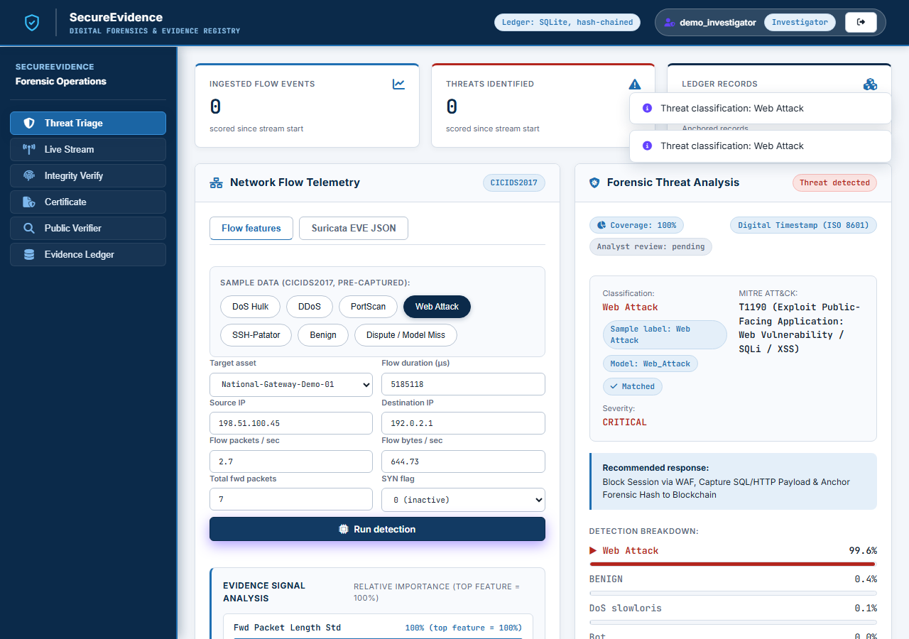
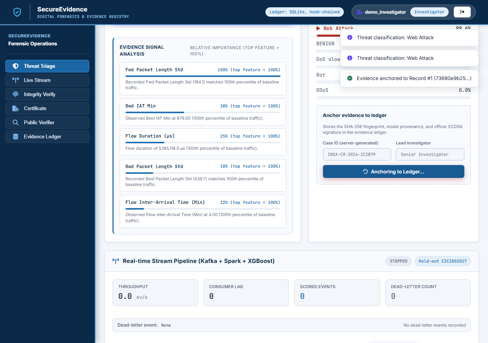
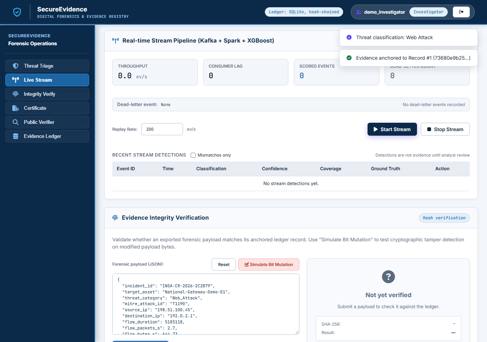
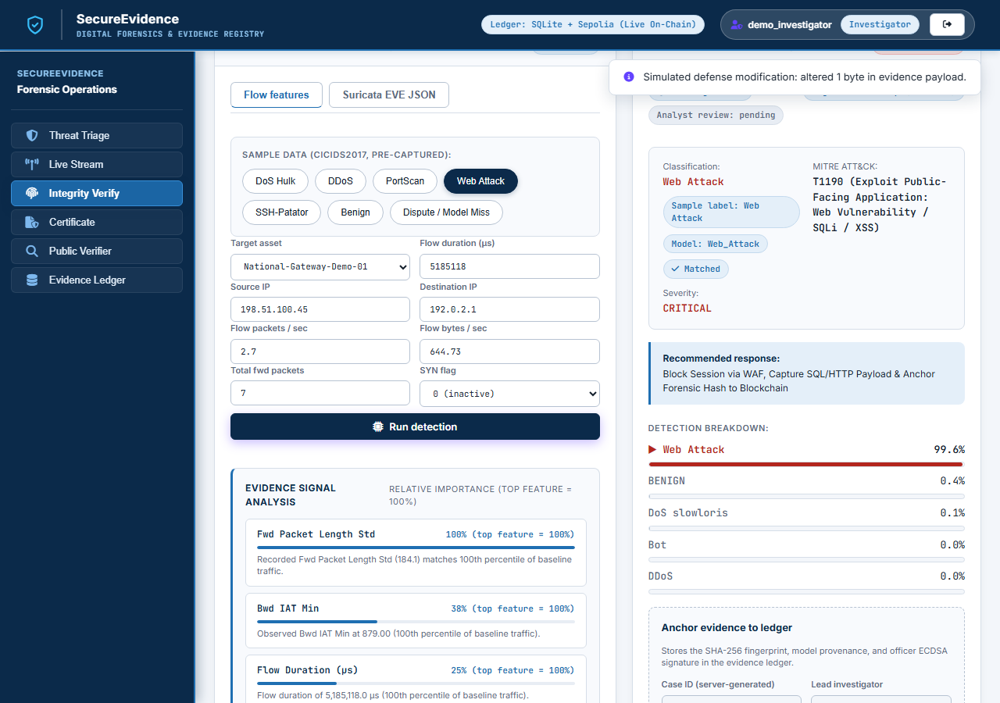
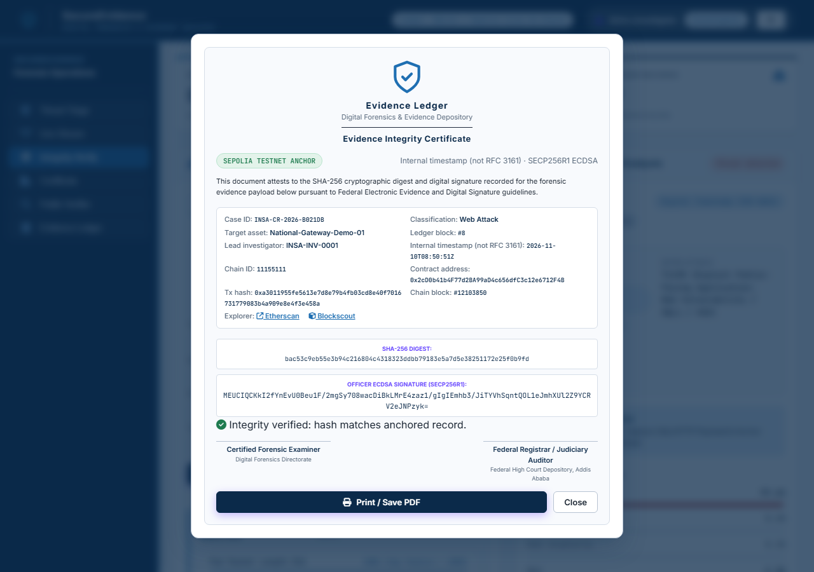

# SecureEvidence
### AI Threat Detection & Tamper-Proof Blockchain Evidence Registry

> **Note:** Graduation project prototype built during the INSA CyberTalent Summer Camp. Developed by **Nathenael Ermias**.

[](https://secureevidence.onrender.com)
[](https://www.python.org/)
[](https://fastapi.tiangolo.com/)
[](https://xgboost.readthedocs.io/)
[](https://soliditylang.org/)
[](https://sepolia.etherscan.io/address/0x2cD0b41b4F77d2BA99aD4c656dfC3c12e6712F4B)
[](https://www.linkedin.com/in/nathenael-ermias-753746428?utm_source=share_via&utm_content=profile&utm_medium=member_android)
[](mailto:nathenaelermias13@gmail.com)

---

## Live Demo

You can try the live application right now in your browser:  
👉 **[https://secureevidence.onrender.com](https://secureevidence.onrender.com)**

### Demo Accounts
The login page has quick-fill buttons so you can test both roles without typing credentials:

| Role | Username | What you can test |
| :--- | :--- | :--- |
| **Investigator** | `demo_investigator` | Run AI threat detection, review TreeSHAP feature explanations, anchor evidence to the Sepolia blockchain, test tampering, and generate court certificates. |
| **System Admin** | `demo_admin` | Inspect audit logs, check ledger health, and manage system settings. |

*Active Smart Contract on Ethereum Sepolia Testnet:*  
[`0x2cD0b41b4F77d2BA99aD4c656dfC3c12e6712F4B`](https://sepolia.etherscan.io/address/0x2cD0b41b4F77d2BA99aD4c656dfC3c12e6712F4B)

---

## Why I Built SecureEvidence

When digital forensics teams investigate cyber incidents, a common challenge in court is proving data integrity:

> *"How can the court be certain that the log files, packet captures, and evidence were not modified after they were seized?"*

Standard server logs and regular database records can easily be edited or deleted by anyone with administrator access. Defense attorneys routinely challenge digital evidence by arguing that timestamps, IP addresses, or packet details could have been tampered with.

I built **SecureEvidence** to solve this problem by connecting three pieces into a single, seamless workflow:

1. **AI Threat Detection**: An **XGBoost** model (trained on the benchmark **CICIDS2017** dataset) analyzes network traffic and classifies it across 12 threat types. It uses **TreeSHAP** to explain *why* it flagged the traffic (e.g. abnormal packet size, flow duration, or SYN flag patterns).
2. **Cryptographic Sealing**: When an investigator verifies a threat, the system generates a deterministic **SHA-256 canonical hash** of the entire evidence record and signs it with an officer ECDSA digital signature.
3. **Dual-Layer Immutability**:
   - **Local SQLite Hash Chain**: Every record embeds the hash of the previous record (`prev_hash`), protected by database triggers that strictly reject any `DELETE` or `UPDATE` queries.
   - **Public Ethereum Sepolia Blockchain**: The cryptographic fingerprints (`evidenceHash`, `rawArtifactHash`, `merkleRoot`) are anchored on-chain into a Solidity smart contract (`EvidenceTracker.sol`).

If anyone later changes even a single letter, number, or timestamp in the evidence file, the recalculated hash will not match the on-chain fingerprint, immediately exposing the tampering.

---

## System Architecture

```text
       Incoming Network Traffic / Flow Telemetry
                         │
                         ▼
        ┌───────────────────────────────────┐
        │   1. Telemetry Ingestion Layer    │
        │      (Validation & 77 Features)   │
        └─────────────────┬─────────────────┘
                          │
                          ▼
        ┌───────────────────────────────────┐
        │    2. AI Threat Detection Engine   │
        │   (XGBoost + TreeSHAP Explanation)│
        └─────────────────┬─────────────────┘
                          │
                          ▼
        ┌───────────────────────────────────┐
        │      3. FastAPI Forensic API       │
        │  (SHA-256 Digest & ECDSA Signing) │
        └─────────┬───────────────────┬─────┘
                  │                   │
         Canonical Hash         JSON Payloads
                  │                   │
                  ▼                   ▼
    ┌─────────────────────────┐  ┌─────────────────────────┐
    │  4. Dual Evidence Store │  │  5. Forensic Web UI     │
    │  - SQLite Hash Chain    │  │  - Real-time Detection  │
    │  - Sepolia Smart Contract│ │  - 1-Click Anchoring    │
    │  - On-Chain Head Anchors│  │  - Interactive Tamperer │
    │  (Immutable & Verifiable)  │  - Official Certificate │
    └─────────────────────────┘  └─────────────────────────┘
```

---

## Key Features

### 1. AI Threat Detection & Explainability (`ai_engine/`)
- **Trained on CICIDS2017**: Detects 12 attack categories including DDoS, DoS Hulk, PortScan, Botnets, SSH-Patator, Web Attacks (SQL Injection / XSS), and normal Benign traffic.
- **TreeSHAP Explainability**: Rather than giving an unexplained prediction score, the UI highlights the top network parameters (e.g., flow inter-arrival times, packet length variance, header length) that drove the classification.
- **Data Quality Safeguard**: Telemetry must contain at least 60% valid flow parameters; incomplete vectors are safely flagged rather than guessed.
- **Model Training Pipeline**: Includes `ai_engine/train.py` to retrain, scale, and evaluate models from scratch.

### 2. Blockchain & Hash-Chained Evidence Ledger (`blockchain/`)
- **Sepolia Smart Contract (`EvidenceTracker.sol`)**: Stores 32-byte cryptographic fingerprints on Ethereum testnet with role-based access (`ADMIN_ROLE`, `ANALYST_ROLE`, `AUDITOR_ROLE`).
- **Privacy-Preserving (Hashes Only)**: Sensitive raw payloads, internal IP addresses, and private telemetry stay local; only cryptographic digests are placed on the blockchain.
- **Local SQLite Hash Chain**: Local records are linked sequentially from Genesis block `#0` to the latest head. SQLite triggers permanently forbid editing or deleting entries.
- **Officer Non-Repudiation**: Evidence submissions are signed using ECDSA key pairs tied to the investigating officer's identity.

### 3. Interactive Tamper Verification (`frontend/`)
- **Live Tamper Testing**: An integrated JSON editor lets investigators or evaluators change a byte or timestamp and click "Verify". The engine immediately detects the cryptographic mismatch and shows a side-by-side diff.
- **Public Verifier**: Allows anyone with a case JSON or SHA-256 hash to independently verify evidence authenticity without needing a login.

### 4. Court-Admissible Evidence Certificate
- Generates an official, printable **Digital Evidence Certificate** with:
  - Complete chain of custody and officer credentials.
  - SHA-256 hashes for the evidence and raw telemetry.
  - Live Sepolia transaction hash and block number with clickable Etherscan links.
  - Statutory references to Ethiopian cybercrime legislation (*Computer Crime Proclamation No. 958/2016*).

### 5. Big Data Streaming Simulation (`big_data/`)
- Simulates real-time telemetry streaming using Spark Structured Streaming and sliding 1-minute window metrics.

---

## Screenshots

### 1. Role-Based Access Control
Separate roles for investigators and system administrators with quick-login buttons for demonstration.


---

### 2. Threat Triage & TreeSHAP Feature Explainability
XGBoost threat classification with real-time TreeSHAP attributions showing the exact statistical features driving the alert.


---

### 3. Blockchain Evidence Anchoring
Anchoring forensic evidence hashes to the live Sepolia smart contract and local hash-chained ledger.


---

### 4. Big Data Streaming Pipeline
Simulated high-throughput telemetry ingestion with 1-minute sliding window metrics and live threat monitoring.


---

### 5. Cryptographic Tamper Detection
Modifying even a single character in the seized evidence instantly causes a cryptographic hash mismatch, catching tampering on the spot.


---

### 6. Official Court Evidence Certificate
Court-ready forensic certificate complete with case details, cryptographic hashes, and clickable on-chain Etherscan verification links.


---

## Local Setup & Installation

### Prerequisites
- Python 3.12 (or 3.11+)
- Node.js 18+ (for running smart contract tests)
- Git

### 1. Clone the Repository
```bash
git clone https://github.com/Nathenael11/SecureEvidence.git
cd SecureEvidence
```

### 2. Set Up Python Environment
```bash
# Create virtual environment
python -m venv venv

# Activate on Windows:
.\venv\Scripts\activate

# Activate on Linux/macOS:
source venv/bin/activate

# Install dependencies
pip install -r requirements.txt
```

### 3. Install Smart Contract Dependencies
```bash
npm install
```

### 4. Run the Application
```bash
# Using uvicorn:
python -m uvicorn backend.main:app --host 0.0.0.0 --port 8000 --reload

# Or on Windows using the batch script:
.\run_web.bat
```
Open **http://localhost:8000** in your browser.

---

## Running Automated Tests

The project includes thorough test suites covering AI inference, cryptographic hashing, API endpoints, and smart contracts:

```bash
# Run all Python backend & AI tests (83 tests)
pytest tests/ -v

# Run Solidity smart contract tests (18 tests)
npx hardhat test

# Run secrets safety scanner
python scripts/check_secrets.py
```

---

## REST API Summary

| Method | Endpoint | Access | Purpose |
|:---|:---|:---|:---|
| `POST` | `/auth/login` | Public | Authenticates credentials and returns JWT access token |
| `POST` | `/detect` | Investigator, Admin | Evaluates network telemetry with XGBoost and TreeSHAP |
| `POST` | `/evidence/store` | Investigator, Admin | Anchors evidence hash to Sepolia blockchain & local SQLite ledger |
| `POST` | `/evidence/verify` | Authenticated | Checks evidence integrity against the ledger with a byte-level diff |
| `POST` | `/evidence/verify-public` | Public | Allows external verification of evidence JSON or hash |
| `GET` | `/evidence` | Authenticated | Lists all anchored forensic records |
| `GET` | `/cases/{case_id}` | Authenticated | Retrieves the complete chain of custody for a case |
| `GET` | `/stats` | Authenticated | Returns operational statistics and ledger health |
| `GET` | `/health` | Public | Health check and cached ledger integrity status |

*Interactive Swagger documentation is available at `/docs` when the app is running.*

---

## Project Structure

```text
SecureEvidence/
├── ai_engine/                         # AI detection, models & training
│   ├── detector.py                    # XGBoost inference & TreeSHAP attributions
│   ├── flow_preprocessor.py           # Feature extraction & coverage checks
│   ├── train.py                       # End-to-end model training script
│   └── models/                        # Serialized model, scaler, and metadata
├── backend/                           # FastAPI backend
│   ├── main.py                        # API routes, CORS & application lifecycle
│   ├── config.py                      # Application settings & environment parsing
│   ├── security.py                    # Password hashing (bcrypt) & JWT verification
│   ├── user_store.py                  # User authentication store & rate limiting
│   ├── schemas.py                     # Pydantic request/response schemas
│   └── services/                      # Detection, Evidence, and Certificate services
├── big_data/                          # Spark Structured Streaming simulation
├── blockchain/                        # Smart contracts & cryptographic ledger
│   ├── contracts/EvidenceTracker.sol  # Solidity smart contract
│   ├── ledger_store.py                # SQLite hash chain with immutability triggers
│   ├── web3_client.py                 # Sepolia / Hardhat Web3 client
│   ├── merkle_tree.py                 # Merkle tree batching
│   ├── digital_signature.py           # SECP256R1 ECDSA officer signatures
│   └── fixtures/seed_ledger.json      # Pre-anchored Sepolia ledger records
├── frontend/                          # Web UI (HTML, CSS, Vanilla JS)
├── deployments/                       # Contract deployment records (Sepolia / Local)
├── docs/                              # Screenshots & benchmark documentation
├── scripts/                           # Deploy, test, and verification helper scripts
├── tests/                             # Pytest test suite & fixtures
├── hardhat.config.js                  # Hardhat configuration
├── Dockerfile                         # Container build file
├── render.yaml                        # Render Cloud deployment blueprint
└── requirements.txt                   # Pinned Python dependencies
```

---

## Current Prototype Scope & Next Steps

This project is a functional graduation prototype. While it delivers an end-to-end working system, here is an honest look at its current design choices and how they could be improved for production:

1. **Investigator Key Storage**: In this prototype, demo officer ECDSA keys are simulated in software. In a production government deployment, investigator private keys would be stored on hardware tokens (FIPS 140-2 smart cards) so keys never touch the web server.
2. **Blockchain Network**: The prototype anchors to the public Ethereum Sepolia testnet, which is great for open evaluation. A production judiciary system would typically deploy on a private consortium blockchain run between partner institutions (e.g. INSA, courts, and telecom providers).
3. **Certified Timestamping**: Timestamps currently use cryptographic internal server time. Future iterations could integrate an accredited RFC 3161 national Time Stamping Authority (TSA).

---

## Acknowledgments

I would like to express my sincere gratitude to:
- **INSA & The CyberTalent Program**: For organizing the summer camp and creating an incredible environment for learning advanced cyber defense and software engineering.
- **Summer Camp Coordinators & Staff**: For their hard work, dedication, and support throughout the program.
- **My Mentors**: A heartfelt thank you to **Mikiyas**, **Abreham**, **Inas**, **Hanamariam**, and **Selam** for their invaluable guidance, critiques, and continuous advice across AI, Big Data, and Blockchain systems.

---

## Author

**Nathenael Ermias**  
- **LinkedIn**: [Nathenael Ermias](https://www.linkedin.com/in/nathenael-ermias-753746428?utm_source=share_via&utm_content=profile&utm_medium=member_android)  
- **Email**: [nathenaelermias13@gmail.com](mailto:nathenaelermias13@gmail.com)  
- **GitHub**: [@Nathenael11](https://github.com/Nathenael11)

---

## Disclaimer
*This project was developed for academic, research, and demonstration purposes as part of the INSA CyberTalent graduation program. It provides technical proof of data integrity under relevant electronic evidence principles.*
